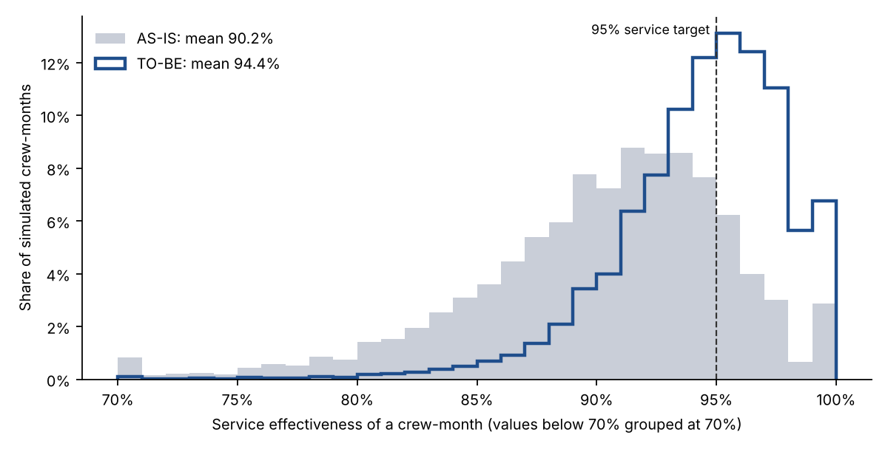
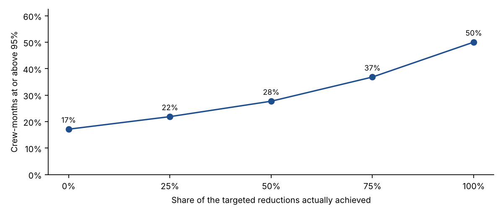

# Logiflex: testing a process redesign with Monte Carlo simulation

Before a company spends money on a redesign, it should know how likely the redesign is to deliver. This repository simulates service effectiveness at **Logiflex**, a last-mile furniture delivery-and-assembly provider. It compares the current process (AS-IS) with the redesign my team proposed (TO-BE), and stress-tests what happens if the redesign under-delivers.

> **Context.** Capstone project for *Laboratory of Analysis and Modeling of Processes*, Politecnico di Milano (team of 5). The case is didactic: inspired by a real company, with operating data provided by the course. The team built the original model in Excel. This repository reproduces it in Python and adds a stress test. I wrote it with AI-assisted coding and checked it against the original spreadsheet.
> Full case study: [alessandromorabito.github.io/#logiflex](https://alessandromorabito.github.io/#logiflex)



## The question

Deliveries were being rescheduled for transport problems, assembly problems of three types, and customer-side reasons. Every rescheduled delivery is a customer not served that month. The redesign targets each cause: new planning and sizing of crews, clearer process ownership, and an integrated information system. The question for management was simple: **how much better would service be, and how sure can we be?**

## The model

The unit of analysis is a **crew-month**. For each simulated crew-month:

1. Draw the number of **delivery requests** from its empirical distribution.
2. For each of the **five rescheduling causes**, draw a rescheduling rate from its own empirical distribution, apply it to the requests, and cap it at the historical maximum for that cause.
3. **Service effectiveness = customers served ÷ delivery requests.**

The distributions were fitted on **1,390 cleaned crew-month records**, out of 1,483 raw records. Sampling uses the inverse-transform method, the same logic as `VLOOKUP(RAND(), …, TRUE)` in the original spreadsheet.

**TO-BE** applies the reductions in rescheduling rates that the redesign targets, cause by cause:

| Cause | Targeted reduction |
|---|---|
| Transport | −40% |
| Assembly type 1 (bedrooms, wardrobes) | −50% |
| Assembly type 2 (kitchens, living rooms) | −50% |
| Assembly type 3 | −50% |
| Customer and client company | −40% |

## Results (100,000 runs per scenario)

| Scenario | Mean effectiveness | 5th–95th percentile | Crew-months ≥ 95% | Rescheduled deliveries per crew-month |
|---|---|---|---|---|
| AS-IS | 90.2% | 80.0% – 97.4% | 17% | 7.7 |
| TO-BE | 94.4% | 88.0% – 100% | 50% | 4.5 |

The redesign raises mean effectiveness by about **4.3 percentage points**. More importantly, it **narrows the bad tail**: the worst 5% of crew-months move from about 80% to about 88%. The share of months that meet a 95% service target roughly **triples**.

Our original Excel model ran 1,000 draws and gave 89.6% (AS-IS) and 94.4% (TO-BE). This reproduction converges to the same picture with far more draws.

## Stress test: what if the redesign under-delivers?

The reduction targets are assumptions, so the decision should not depend on hitting them exactly. The script scales them from 0% (nothing changes) to 100% (fully delivered):



| Share of targeted reductions achieved | Mean effectiveness | Crew-months ≥ 95% |
|---|---|---|
| 0% | 90.2% | 17% |
| 25% | 91.2% | 22% |
| 50% | 92.2% | 28% |
| 75% | 93.3% | 37% |
| 100% | 94.4% | 50% |

Even at half of the targeted improvement, service improves materially. The benefit grows steadily with delivery rather than depending on a single all-or-nothing outcome.

## Run it

```bash
pip install -r requirements.txt
python simulate.py            # 100,000 runs, prints the tables above
python simulate.py --plot     # also regenerates the figures
python simulate.py --runs 1000 --seed 7
```

## Repository contents

```
simulate.py   the model, the stress test and the figures
data/         empirical distributions (cumulative probability, value),
              aggregated from the cleaned records; the records themselves
              are course data and are not published
figures/      charts used in this README
```

## Limitations

- Causes are sampled **independently**. In reality a bad month for transport may also be a bad month for assembly. Correlated draws would widen the tails.
- The caps use the historical maximum for each cause, which bounds extreme months.
- The reduction targets come from the redesign plan, not from observed results. That is why the stress test matters.

## My role

In a team of five, I led the redesign of the processes and the organization around process owners, mapped the TO-BE processes in SAP Signavio, and worked on the financial feasibility (Monte Carlo and NPV), the KPI dashboard and the technology risk assessment. This Python version exists so the model can be read, rerun and challenged without opening a spreadsheet.
